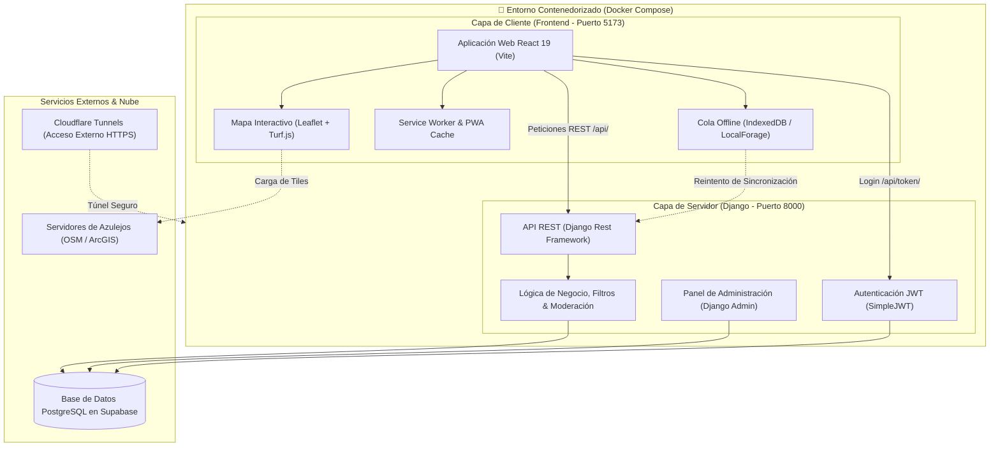

# 🏗️ Arquitectura del Sistema - Mapa Secreto

## 1. Diagrama de Componentes y Orquestación

El sistema implementa una arquitectura **Headless (desacoplada)** y **contenedorizada**, donde el Frontend (React PWA) y el Backend (Django REST Framework) operan de forma independiente y se orquestan mediante **Docker Compose**.

---

## 2. Justificación Técnica de Componentes

### Frontend: React 19 + Vite + Leaflet + PWA
* **React 19 & Vite:** Proporciona un entorno ultrarrápido con renderizado reactivo para actualizar dinámicamente pines, popups y rutas sin recargar la página.
* **Leaflet.js + Turf.js:** Motor cartográfico ligero y de código abierto. Permite alternar estilos visuales (OpenStreetMap y ArcGIS World Topo) sin costos de licencias ni límites de API keys privadas. Turf.js se encarga de los cálculos espaciales y distancias de rutas en el cliente.
* **PWA & Offline Queue (`localforage`):** Garantiza que la aplicación pueda instalarse en dispositivos móviles y que los exploradores urbanos puedan seguir registrando comercios y rutas en zonas con mala señal, sincronizando los datos cuando regrese la conexión.

### Backend: Django 5.2 + Django REST Framework (DRF)
* **Django & Django Admin:** Facilita la gobernanza de datos y la moderación de sugerencias de tiendas de forma nativa a través del panel de administración (`/admin`).
* **Django REST Framework (DRF):** Expone endpoints estructurados en formato JSON. Controla los permisos y la privacidad (por ejemplo, ocultando tiendas no verificadas a usuarios no autorizados).
* **SimpleJWT:** Gestión de sesiones segura y sin estado (stateless) mediante tokens de acceso y refresco de corta duración.

### Base de Datos: PostgreSQL (Supabase)
* **PostgreSQL:** Motor relacional robusto con excelente precisión decimal para coordenadas geográficas (`DecimalField` con alta precisión) y soporte nativo para campos semiestructurados (`JSONField`) usados en horarios, redes sociales y coordenadas de rutas.

### Contenedorización: Docker & Docker Compose
* **Docker Compose:** Orquesta los dos servicios principales (`backend` y `frontend`) aislando versiones de Python, Node.js y dependencias nativas, permitiendo un encendido unificado (`docker compose up`) y portabilidad total a servidores de producción.

---

## 3. Decisiones de Diseño Clave

1. **Arquitectura Offline-First:** Las acciones críticas de registro no fallan si se pierde la conexión; se almacenan en una cola local en IndexedDB y se reintentan mediante listeners de red (`window.addEventListener('online')`).
2. **Seguridad y Moderación por Capas:** Las tiendas creadas por la comunidad requieren revisión de un usuario con permisos de administrador (`is_staff`) antes de ser visibles en el mapa público.
3. **Multi-Tema Dinámico:** Capacidad de alternar la identidad visual completa del mapa (paletas de color, tipografía y servidor de mapas) entre tres modos: *Boutique*, *Cyberpunk* y *Aventura*.
4. **Desacoplamiento Estricto:** Al consumir el backend mediante una API REST documentada, en el futuro se pueden conectar clientes nativos (Flutter, React Native) o automatizaciones externas sin modificar la lógica del servidor.