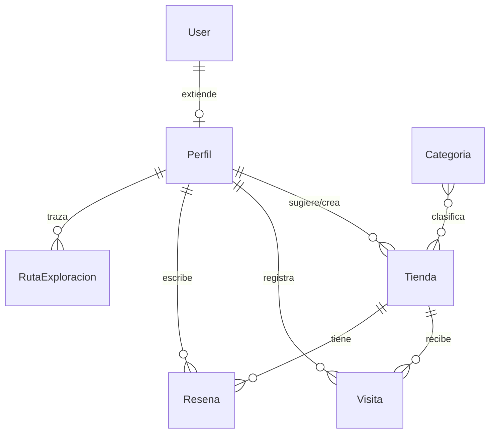

# 🗺️ Mapa Secreto — Documento de Contexto Integral para IA

> **Instrucciones para la IA lectora:** Este documento contiene el contexto arquitectónico, técnico, funcional e histórico completo del proyecto **Mapa Secreto**. Utiliza esta información como fuente de verdad para responder dudas, proponer refactorizaciones, generar nuevas características o depurar errores sin alucinar tecnologías ajenas al proyecto.

---

## 1. 🎯 Visión y Propósito del Proyecto

**Mapa Secreto** es una plataforma colaborativa y gamificada (formato **PWA - Progressive Web App**) diseñada para el descubrimiento, registro y exploración de comercios locales, "picadas" ocultas, cafeterías de especialidad, tiendas vintage y bazares independientes en ciudades (inicialmente centrado en La Serena / Coquimbo, Chile).

### Pilares del producto:
1. **Descubrimiento Visual:** Mapa interactivo con clusters dinámicos, filtros por categoría, búsqueda en tiempo real y visualización térmica (heatmap).
2. **Exploración Urbana en Vivo:** Registro de rutas recorridas en tiempo real mediante GPS (`navigator.geolocation.watchPosition`), permitiendo a los exploradores marcar tramos de calles como completados (verde) o incompletos (amarillo).
3. **Resiliencia Offline-First:** Capacidad de registrar tiendas o rutas en zonas con poca señal mediante una cola de sincronización offline persistida en IndexedDB (`localforage`).
4. **Moderación y Roles:** Acceso público de lectura para tiendas verificadas; acceso con autenticación JWT para exploradores y administradores para moderar, crear y editar contenido.

---

## 2. 🧱 Stack Tecnológico

### Frontend
- **Framework & Bundler:** React 19 + Vite 7.
- **Estilos:** Tailwind CSS v4 + Vanilla CSS dinámico.
- **Mapas & Geometría:** 
  - `leaflet` (v1.9.4) + `react-leaflet` (v5.0.0).
  - `react-leaflet-cluster` (agrupamiento de marcadores con píldoras de conteo personalizadas).
  - `leaflet.heat` (mapa de calor para concentración de locales).
  - `@turf/turf` (cálculos geoespaciales, distancias y bounding boxes).
- **Métricas & Gráficos:** `recharts` (para el dashboard administrativo).
- **Almacenamiento Offline & Red:** `axios`, `localforage` (IndexedDB para la cola offline).
- **PWA:** `vite-plugin-pwa` con Service Worker registrado, soporte offline e iconos 192x192 / 512x512.
- **Compresión de Multimedia:** `browser-image-compression` para optimizar fotos antes de subirlas.

### Backend
- **Framework:** Python 3.12 + Django 5.2.
- **API Engine:** Django REST Framework (DRF).
- **Autenticación:** `djangorestframework_simplejwt` (JSON Web Tokens con payload de expiración).
- **CORS & Seguridad:** `django-cors-headers` (habilitado para pruebas locales y túneles).
- **Imágenes:** `Pillow` (procesamiento y almacenamiento de multimedia en `/media/tiendas/fotos/`).

### Infraestructura & Base de Datos
- **Base de Datos:** PostgreSQL relacional alojada en **Supabase** (conectada vía `psycopg2-binary`).
- **Contenedores:** Docker & Docker Compose (`backend` en puerto 8000, `frontend` en puerto 5173).
- **Exposición Externa / Testing Móvil:** Cloudflare Tunnels (`cloudflared`) para túneles HTTPS seguros requeridos para la instalación de la PWA.

---

## 3. 🗄️ Esquema de Base de Datos y Modelos Django (`backend/api/models.py`)



### Detalle de Modelos:
1. **`Perfil`**:
   - `id`: `OneToOneField(User, primary_key=True, related_name='perfil')`
   - `nombre_usuario`: `CharField(150)`
   - `puntos_explorador`: `IntegerField(default=0)`
   - `creado_en`: `DateTimeField(auto_now_add=True)`

2. **`Categoria`**:
   - `id`: `UUIDField(primary_key=True)`
   - `nombre`: `CharField(100, unique=True)`
   - `icono`: `CharField(50)` (nombre del icono/emoji)
   - `color_hex`: `CharField(7, default="#3b82f6")`

3. **`Tienda`**:
   - `id`: `UUIDField(primary_key=True)`
   - `categorias`: `ManyToManyField(Categoria, related_name='tiendas')`
   - `creado_por`: `ForeignKey(Perfil, on_delete=SET_NULL, null=True)`
   - `nombre`: `CharField(200)`
   - `slug`: `SlugField(unique=True, auto-generado)`
   - `descripcion`: `TextField(blank=True)`
   - `latitud` / `longitud`: `DecimalField(max_digits=20/21, decimal_places=16)`
   - `rango_precios`: `IntegerField(1 a 4)`
   - `direccion`: `CharField(255)`
   - `contacto`: `JSONField(default=dict)` (ej: `{"ig": "@tienda", "wsp": "+569..."}`)
   - `horarios`: `JSONField(default=dict)` (ej: `{"lunes": "09:00-18:00"}`)
   - `verificado`: `BooleanField(default=False)`
   - `url_imagen`: `URLField` / `imagen`: `ImageField(upload_to='tiendas/fotos/')`
   - `calificacion_promedio`: `DecimalField(default=0.00)`

4. **`Visita`**:
   - Relaciona un `Perfil` con una `Tienda`. Restricción: `unique_together = ('usuario', 'tienda')` para evitar farming de puntos.

5. **`Resena`**:
   - `usuario`: `ForeignKey(Perfil)`
   - `tienda`: `ForeignKey(Tienda)`
   - `puntuacion`: `IntegerField(1 a 5)`
   - `comentario`: `TextField`

6. **`RutaExploracion`**:
   - `nombre`: `CharField(150)`
   - `coordenadas`: `JSONField(default=list)` (lista de tuplas `[[lat, lng], [lat, lng]]`)
   - `estado`: `CharField` (`'verde'` = completado, `'amarillo'` = incompleto)
   - `creado_por`: `ForeignKey(Perfil)`

---

## 4. 🌐 Endpoints y Lógica de Permisos (`backend/api/views.py`)

- **`GET /api/tiendas/`**:
  > ⚠️ **Regla Crítica de Negocio:** En `TiendaViewSet.get_queryset()`, si el usuario **no** es staff (`not request.user.is_staff`), la API filtra automáticamente solo las tiendas con `verificado=True`. Por tanto, los usuarios invitados o no autenticados solo ven tiendas verificadas por el administrador.
- **`POST /api/tiendas/`**: Asigna `creado_por = request.user.perfil` y marca `verificado = True` para staff.
- **`GET /api/categorias/`**: Listado de categorías disponibles.
- **`GET / POST / PATCH / DELETE /api/rutas-exploracion/`**: CRUD de líneas y tramos de calles recorridas.
- **`POST /api/token/` & `/api/token/refresh/`**: Endpoints de SimpleJWT para inicio de sesión.

---

## 5. 🎨 Características del Frontend (`frontend/src/`)

### A. Sistema de Temas Dinámicos (`App.jsx`)
La aplicación cuenta con 3 personalidades visuales intercambiables que alternan colores, tipografías y fuentes de mapas:
1. **Boutique (Predeterminado):** Tipografía Outfit, estética limpia con azulejos de OpenStreetMap estándar (`https://{s}.tile.openstreetmap.org/{z}/{x}/{y}.png`).
2. **Cyberpunk:** Tipografía Space Grotesk, tonos oscuros y neón con azulejos OSM Humanitarian (`https://{s}.tile.openstreetmap.fr/hot/{z}/{x}/{y}.png`).
3. **Aventura:** Tipografía Lora, estética cartográfica vintage/tierra con azulejos topográficos de ArcGIS (`https://server.arcgisonline.com/ArcGIS/rest/services/World_Topo_Map/MapServer/tile/{z}/{y}/{x}`).

### B. Modos de Mapa (`Mapa.jsx`)
- **Modo Clusters:** Agrupa tiendas cercanas con burbujas estilizadas que indican `"🏬 X lugares"`.
- **Modo Térmico (Heatmap):** Oculta pines y dibuja un mapa de calor (`leaflet.heat`) según la densidad de tiendas registradas.
- **Trazado de Rutas:** Muestra polilíneas en verde (calles cubiertas) y amarillo (calles pendientes de explorar), con popup interactivo para cambiar el estado o eliminar el tramo.

### C. Sistema de Cola Offline (`frontend/src/utils/offlineQueue.js`)
- Utiliza `localforage` para almacenar peticiones fallidas o ejecutadas sin internet en una cola local `offline_task_queue`.
- Escucha los eventos `online` del navegador para sincronizar automáticamente reintentando las peticiones al backend cuando la red regresa.

### D. Panel Administrativo (`AdminDashboard.jsx`)
- Accesible únicamente cuando existe un token JWT válido.
- Métricas en tiempo real: total de tiendas, tasa de verificación, distribución por categoría y gráfico de barras/pastel vía Recharts.

---

## 6. 🚀 Ejecución y Comandos

### Opción A: Docker Compose (Recomendada para unificar)
```bash
# Iniciar frontend y backend simultáneamente
docker compose up

# Detener los contenedores
docker compose down
```
- **Frontend:** `http://localhost:5173`
- **Backend API:** `http://localhost:8000`
- **Django Admin:** `http://localhost:8000/admin`

### Opción B: Ejecución Nativa (Menor consumo de RAM)
```bash
# Terminal 1: Backend Django
cd backend
.\venv\Scripts\activate
python manage.py runserver 0.0.0.0:8000

# Terminal 2: Frontend React
cd frontend
npm run dev -- --host
```

### Credenciales de Desarrollo:
- **Usuario Admin:** `admin`
- **Contraseña Admin:** `demo123`

---

## 7. 🛠️ Historial de Problemas Resueltos y Decisiones Técnicas

1. **Problema de API Key en Mapas:** Originalmente se probaban proveedores que exigían API Keys (Mapbox/Jawg). Se resolvió configurando proveedores abiertos (OpenStreetMap y ArcGIS libre) fijando `maxZoom={19}` para evitar solicitudes bloqueadas y pantallas grises al hacer zoom profundo.
2. **Dockerización en Windows:** Se crearon `backend/Dockerfile` y `frontend/Dockerfile` adaptados para Vite (`--host 0.0.0.0`) y montaje de volúmenes de código sin sobreescribir `node_modules`.
3. **Datos no visibles en el Frontend:** Se identificó que las tiendas no verificadas estaban ocultas para usuarios no logueados por diseño en `TiendaViewSet`. Al iniciar sesión con las credenciales de admin, se desplegó la totalidad de los datos.
4. **Espaciado y Layout Responsive:** Se corrigieron solapamientos entre la barra lateral colapsable en desktop y los controles flotantes en mobile.

---

## 8. 💡 Evaluaciones Estratégicas: Docker y n8n

### Sobre Docker:
- **¿Fue buena idea?** Sí. Estandarizó las dependencias de Python y Node, permitiendo desplegar en cualquier servidor en la nube sin inconsistencias de entorno. En desarrollo local en Windows puede usarse Docker o la ejecución nativa si se desea ahorrar RAM.

### Sobre n8n:
- **¿Es necesario para el núcleo de la app?** No. El backend en Django REST Framework maneja de forma eficiente y directa todo el CRUD y la seguridad con PostgreSQL.
- **¿Cuándo se recomienda usar n8n?** Como herramienta satélite de automatización:
  1. *Moderación por bots:* Enviar alertas a Telegram/Discord cuando alguien proponga una tienda con botones `[Aprobar]`/`[Rechazar]`.
  2. *Scraping & Enriquecimiento:* Monitorear cuentas de Instagram locales y procesar datos con IA para cargar borradores de tiendas automáticamente.
